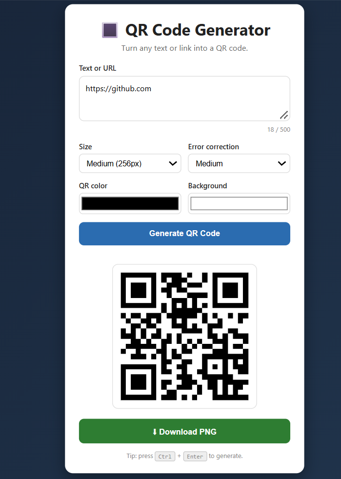

# 🔳 QR Code Generator

A responsive QR code generator built with **HTML, CSS and JavaScript**. Turn any text or link into a QR code, customize it, and download it as a PNG.



## About

This project shows core front-end skills in one app: building a form-based UI with HTML, styling it with CSS Grid and Flexbox, and handling input, validation and file download with JavaScript and the Canvas API.

## Features

- Generate a QR code from any text or URL (up to 500 characters)
- Choose the size: small, medium or large
- Choose the error correction level: Low, Medium, Quartile or High
- Custom QR and background colors
- Input validation with clear error messages
- Warning when both colors are the same
- Download the QR code as a PNG with a white margin so it scans reliably
- Character counter
- `Ctrl + Enter` shortcut to generate
- Responsive design for mobile and desktop

## Tech Used

- **HTML5**: forms, `textarea`, `select` and color inputs
- **CSS3**: Grid, Flexbox, transitions, animations, media queries
- **JavaScript (ES6)**: DOM manipulation, events, validation, `try/catch`
- **Canvas API**: building the downloadable PNG
- **qrcodejs**: a small library loaded from a CDN that encodes the data into a QR code

## Project Structure

```
qr-code-generator/
├── index.html
├── README.md
├── screenshot.png
├── css/
│   └── style.css
└── js/
    └── script.js
```

## How to Run Locally

1. Open the folder in VS Code.
2. Right-click `index.html` and choose **Open with Live Server**, or double-click `index.html` to open it in your browser.

An internet connection is needed because the QR library loads from a CDN.

## What I Learned

- Integrating a third-party library from a CDN
- Validating user input and showing friendly error messages
- Using the Canvas API (`drawImage`, `toDataURL`) to create a downloadable file
- Triggering a file download from JavaScript
- Wiring form controls to live logic
- Building a responsive layout with CSS Grid

## Future Improvements

- Add a "Copy to clipboard" button
- Add presets for Wi-Fi, email and phone number QR codes
- Add a dark mode
- Save a history of generated codes with `localStorage`

## Author

**Tejaswini N**
GitHub: https://github.com/tejaswini-n-cse
